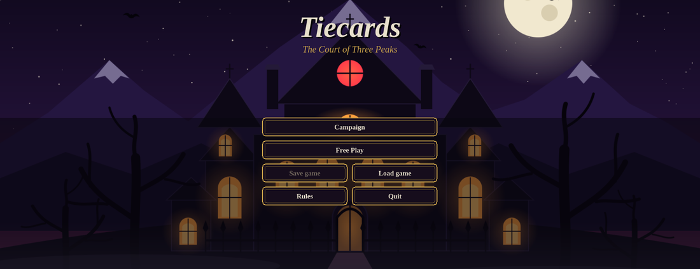
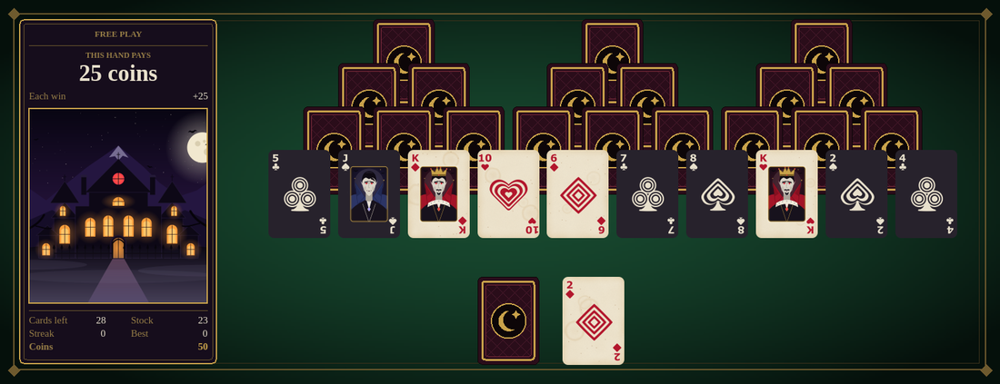
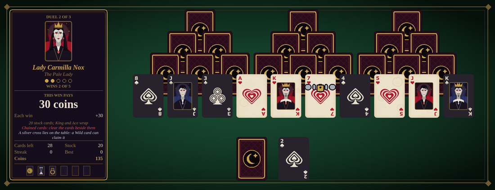
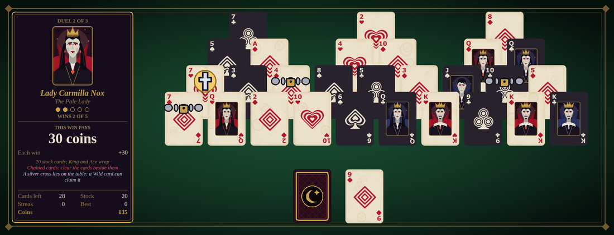
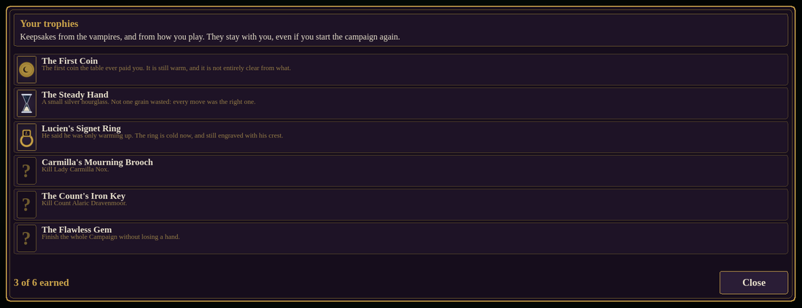
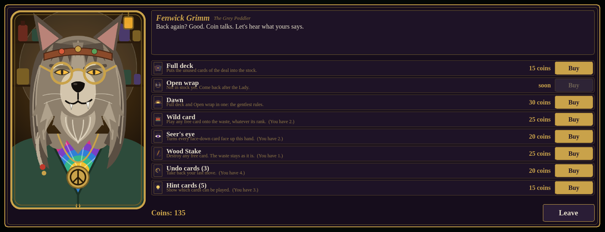
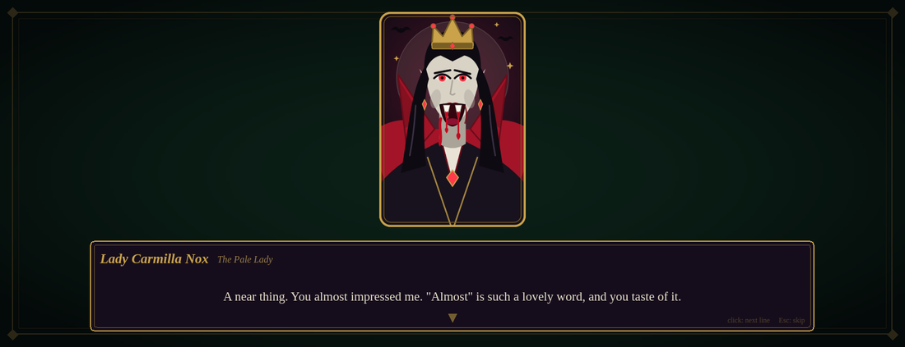

# Tiecards

A gothic Tri Peaks solitaire. Clear three peaks of cards by playing a card one
rank above or below the pile in front of you. Play it as plain solitaire in
**Free Play**, or take on the **Campaign**: duels against three vampires, each
with his own rules and his own trick, and a shopkeeper (Fenwick Grimm) who sells
fixed-price help.

The desktop game runs on Linux and Windows. The same game also runs in a web
browser (tablets and phones included), and can be played offline there.

## Screenshots

The start menu:

Free Play is plain Tri Peaks, with the house in the side panel:

A Campaign hand against Lady Carmilla Nox. The panel shows the duel, what a win
pays and her rules. She chains cards:

The same hand with a Seer's eye used. Face-down cards are shown, and the gold
ring marks the silver cross that a Wild card can claim:

The shelf at the foot of the panel holds the trophies you have earned (six in
all, and nothing about them is random). Tapping it opens the trophy page:

Fenwick Grimm's Store, where everything has a fixed price:

The vampires speak between hands:

## Playing

Start the game and press **Campaign** or **Free Play**. The **Rules** button on
the start menu explains everything: how cards play, missed moves and streaks,
undo and hint cards, the Store and its special cards, each vampire's trick,
saving, and the Records page. The rules text is written in `src/rules.pas`, built
from the same constants the game uses, so it cannot drift from the real numbers.

Things worth knowing before you read the code:

- Every deal is a plain random shuffle. The Campaign changes the rules around
  the shuffle (stock size, King and Ace wrap, a trick per vampire), never the
  shuffle itself.
- There is nothing random in rewards or purchases. Prices are fixed, rewards are
  fixed, and no coin buys a chance at anything. This is a deliberate rule for the
  project.
- You collect trophies for your first win, a perfect hand, each vampire killed, and
  a whole Campaign without losing a hand. They sit on a shelf in the side panel and
  survive restarting the Campaign.
- Style (from the start menu or the Store): card backs, table cloths and the colour of the
  moon over the house. A few are bought at fixed prices and a few are earned with a
  vampire's trophy. They only change how the game looks.
- Relics (the Relics button in the Store, or on the start menu in the middle of a hand): small
  permanent helps against the hard vampires, such as a lockpick that frees one chained card a
  hand. Bought at fixed prices (two can also be earned with trophies), carried in slots that
  grow with each vampire you kill. A relic works the moment you equip it.
- Progress is saved automatically (the hand after every move, coins and cards as
  they change). The Menu also has manual save slots for both modes.

### On a tablet or phone

Open the web version in the browser. Your progress (coins, cards, the campaign and
saved hands) is kept in the browser on that device, separate from the desktop game
and from other devices.

On an iPad or iPhone, Safari deletes a site's saved data after seven days of Safari
use with no visit to that site. A page added to the Home Screen is exempt, so open
the page, tap **Share**, then **Add to Home Screen**, and start the game from that
icon. The game also asks the browser to keep its data.

## Building

Everything below is run from the project folder.

### Linux (Qt5)

You need Free Pascal 3.2.2 and Lazarus 4.8 with the Qt5 widgetset
(`lazbuild --ws=qt5`) and `fpcres` (part of Free Pascal).

    ./build-linux.sh

This packs the pictures and the story into `app/cards.res` (`make-resources.sh`,
generated and not stored in the repository) and builds `build/tiecards`. Sound
uses whichever of `paplay`, `pw-play` or `aplay` is installed; without one the
game is silent. The window carries the moon icon by itself. For an icon in the
application menu, run `tools/install-linux-launcher.sh` (menu entry and icon,
under `~/.local/share`), or `--icon-only` if you made the menu entry yourself and
just want to add `Icon=tiecards` to it.

### Windows (cross-compiled from Linux)

    ./build-windows.sh

Needs `fpc` with the win64 units and Lazarus. The system Lazarus folder is
read-only, so the first run copies it (about 1.5 GB) to
`~/.local/share/tiecards-cross`; delete that folder to refresh it after a Lazarus
upgrade. The result is `build/tiecards.exe`, with the program icon embedded.

### Web

You need pas2js 3.x with its runtime library (the one that comes with the Arch
`fpc` package has no runtime library). Download
`pas2js-linux-x86_64-3.0.1.zip` from
<https://downloads.freepascal.org/fpc/contrib/pas2js/3.0.1/>, unpack it, and run:

    PAS2JS_DIR=/path/to/pas2js-linux-x86_64-3.0.1 web/build.sh

(or unpack it to `~/.local/share/tiecards-pas2js/` and leave `PAS2JS_DIR` unset).
This fills `web/dist/` with plain static files, about 3 MB. Try it with

    cd web/dist && python3 -m http.server 8765

and open `http://127.0.0.1:8765/`; use a server, not a `file://` address. To
publish, copy the contents of `web/dist/` into any folder of a website. Offline
play uses a service worker, which browsers only run on **https** pages (and
localhost). More detail, including how saved games are kept and the iPad
Home Screen advice, is in [`web/README.md`](web/README.md).

## Homepage

`site/` is a one-page homepage for the game (plain HTML and CSS, no scripts, with its own copies of
the pictures in `site/img/`). To publish it, copy the contents of `site/` to a folder on a web server
and put the web build (the contents of `web/dist/`) in a `play/` folder inside it, which is where the
"Play" buttons point. `tools/publish-local.sh [folder]` does both (the default folder is
`~/html/tiecards`). `site/sw.js` is only there to retire the service worker that the game used to
register at that address, before the game moved to `play/`. The download buttons for Linux and
Windows are placeholders until there are releases to link to.

## Versions

The version is `MAJOR.MINOR.PATCH` (a patch for fixes, a minor for anything that changes how
the game plays or what it offers; 1.0 will be the full release). It is written in one place,
`src/version.pas`, and shown small in the corner of the start menu; the Windows program
carries it in its file properties (made from it by `make-resources.sh`). `CHANGELOG.md` records what changed in each version. To
make a release: write its `## X.Y.Z` section in `CHANGELOG.md`, run

    tools/set-version.sh X.Y.Z

commit, and tag the commit `vX.Y.Z`. Every build script runs `tools/check-version.sh`, which
stops the build if the changelog does not start with the version in `src/version.pas`.

## Tests

The rules and the whole game flow are UI-free, so the tests are plain console
programs. Build and run one like this:

    mkdir -p build/lib/tests
    fpc -Mobjfpc -Fusrc -FUbuild/lib/tests -FEbuild tests/testduel.pas
    (cd build && ./testduel)

Each prints `ALL ... TESTS PASSED` (or `FAIL:` lines). `testcontroller` also makes
the sound player print a few harmless "Connection failure" lines when there is no
audio server. Run it with a scratch `XDG_CONFIG_HOME` so it cannot touch your real
saved game.

To check that the same code still works as JavaScript, run

    tools/check-pas2js.sh

which compiles every unit in `src/` and `web/src/` with pas2js and runs all the
test programs under Node. It needs pas2js (see above) and Node, and skips itself
if they are missing. Keep it green after any change to `src/` or `web/src/`.

## Layout

| Folder | What is in it |
| --- | --- |
| `src/` | All the game logic, with no window code: cards, Tri Peaks rules, the session (inventory, undo, hints, special cards), the duel and campaign, save files, the scenes, the story, the rules text, and `gamecontroller.pas`, the whole game flow that both front ends share |
| `app/` | The Lazarus desktop front end (`MainForm`, drawing code, the card back and table drawn in code) |
| `web/` | The browser front end: `web/src` (pas2js code), `index.html`, `glue.js`, the service worker template, `build.sh` |
| `assets/` | Card faces, vampire and shopkeeper portraits, the house, special-card pictures, the icon, and `story/story.ini` (all the dialogue) |
| `tests/` | Console test programs, one per area |
| `docs/` | The screenshots used in this README |
| `site/` | The homepage (one static page and its pictures) |
| `tools/` | The art scripts (Python), `check-pas2js.sh`, the icon builder, and a solver used to tune the vampires' difficulty |

The desktop and the web page are thin: they draw what `GameController` says and
pass clicks back to it, which is why the two behave the same.

### Art

The card faces come from the CC0 "52 playing cards" set by MrEliptik (see
`assets/cards_src/CREDITS.txt`). `tools/make-art.sh` turns them into the shipped
art (recoloured suits, vampire court cards, aged ivory, portraits, the house,
the win screen). It needs Python 3 with Pillow and NumPy, and `rsvg-convert`.
Run it as a whole: its steps depend on each other, and running one alone (for
example only `recolor_cards.py`) overwrites pictures a later step builds on.
`tools/make-icon.sh` rebuilds the Windows icon (needs ImageMagick, `icotool` and
`rsvg-convert`); its result is committed, so you only need it to change the icon.
After changing art, rebuild: the build scripts embed the pictures.

## Story and text

All the dialogue is in `assets/story/story.ini`: the opening, each vampire's
lines, the shopkeeper's pitches. It is embedded in the program, so edit it and
rebuild. The player's rules are separate, in `src/rules.pas`.

## License

MIT, see [`LICENSE`](LICENSE). The card faces are derived from a CC0 set by
MrEliptik (credits in [`assets/cards_src/CREDITS.txt`](assets/cards_src/CREDITS.txt));
the other pictures are drawn by the scripts in `tools/`.
